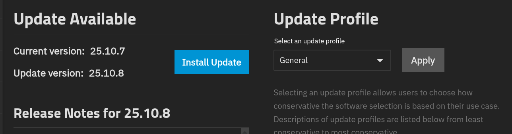
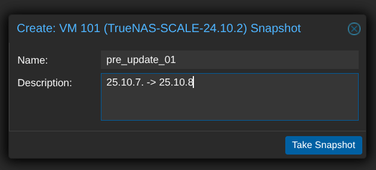
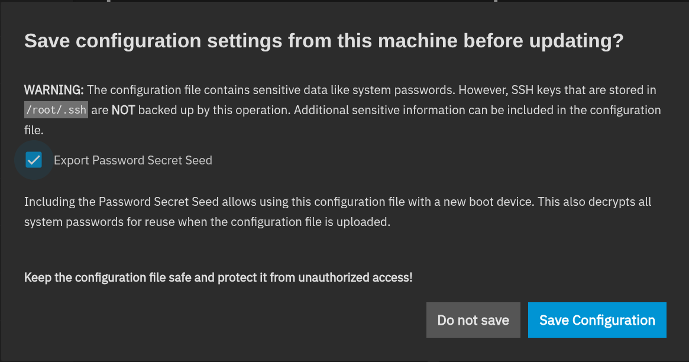
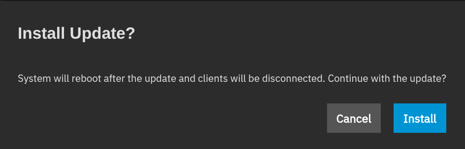
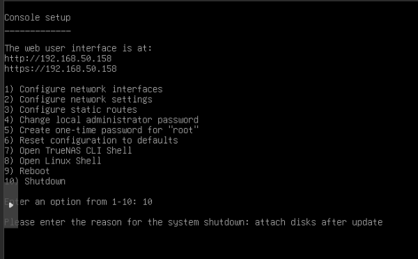
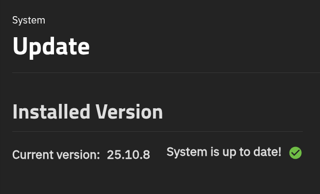

# Virtualized Truenas on Proxmox

## Update Truenas

Updating can be done via GUI or CLI. The procedure is same in both cases.  

> [!CAUTION]
> **The included scripts are meant to be ran on `Proxmox VE host`!** 

### 1. Shutdown Truenas

### 2. Take a snapshot of Truenas


> [!INFO]
> Snapshots should be named uniquely.   

### 3. Detach passed through data disks

List disks attached on your system to get correct `[unique_disk_id_string]` variables for your system.  

```bash
ls -l /dev/disk/by-id/ | grep -v -E '[0-9]$'
```    

Copy `.env.example` to `.env` and modify the file to fit your needs.
```bash
cp .env.example .env 
``` 
Modify the .env file so it has correct variables for detaching and attaching the disks on your system.
```bash
# .env

# for detaching
VMID=101
SCSI1=scsi1
SCSI2=scsi2
SCSI3=scsi3

# for attaching
SCSI1_DISK=/dev/disk/by-id/[unique_disk_id_string]
SCSI2_DISK=/dev/disk/by-id/[unique_disk_id_string]
SCSI3_DISK=/dev/disk/by-id/[unique_disk_id_string]
```

 Use the `detach_disks_truenas.sh` script (needs the .env file above) for removing other than system disk.  

```bash
./detach_disks_truenas
```  

### 4. Start Truenas, login and update new version

Starting Truenas might take some more time than normally as there are some disks missing.



Save the current configuration.  


  
Install the available update.


### 5. Shut down Truenas




### 6. Attach the data disks
```bash
./attach_disks_truenas
```  
```bash
This script will attach disks scsi1, scsi2 and scsi3 to vmid 101. Do you want to proceed? (y/n): y
User confirmed: Yes
Attaching disks...
update VM 101: -scsi1 /dev/disk/by-id/[unique_disk_id_string]
update VM 102: -scsi1 /dev/disk/by-id/[unique_disk_id_string]
update VM 103: -scsi1 /dev/disk/by-id/[unique_disk_id_string]
```
### 7. start Truenas again
Start the Truenas VM with corresponding ID.  

```bash
qm start 101
```

Login and check the current system info.  




### 8. After updating: zpools used space showing incorrectly   
Truenas might sometimes have **trouble showing correct used space of zpools** on the GUI.  

  

However the CLI seems to show the information correctly.  

```bash
zpool list
```  

```bash
NAME        SIZE  ALLOC   FREE  CKPOINT  EXPANDSZ   FRAG    CAP  DEDUP    HEALTH  ALTROOT
boot-pool    63G  36.6G  26.4G        -         -    35%    58%  1.00x    ONLINE  -
fast256     232G  58.4G   174G        -         -     6%    25%  1.00x    ONLINE  /mnt
tank       14.5T  5.01T  9.54T        -         -     3%    34%  1.00x    ONLINE  /mnt
```

This might be due to browser caching or service glitch. Restarting Truenas didn't fix this for me but restarting middlewared did the trick.  

```bash
sudo systemctl restart middlewared
```  
  
Enjoy!
